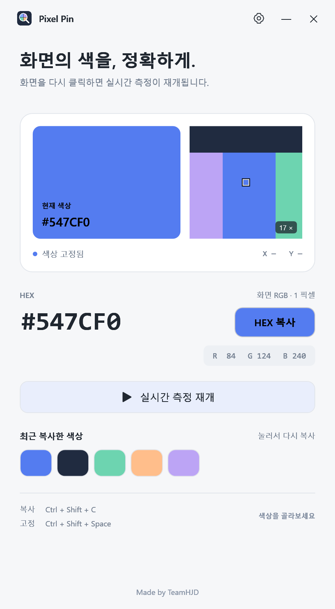
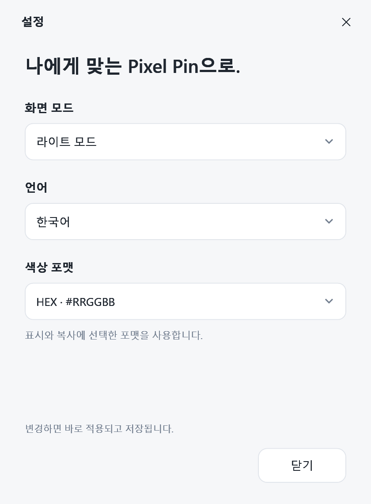
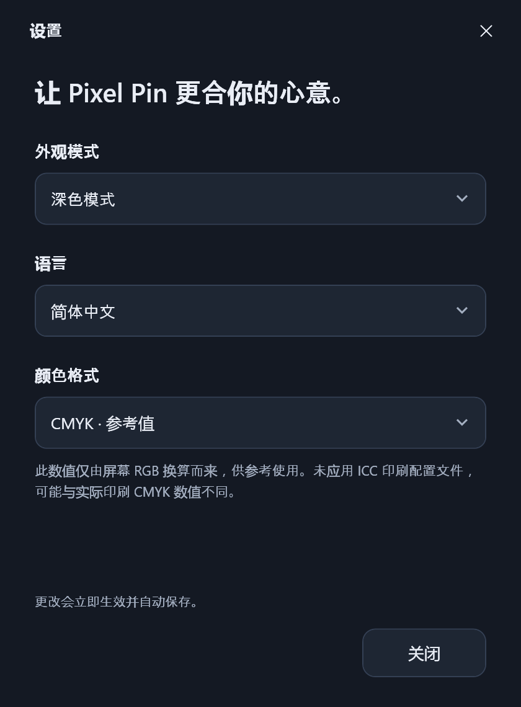

<div align="center">

**한국어** · [English](docs/README.en.md) · [简体中文](docs/README.zh-CN.md)

<br />


# Pixel Pin

**화면의 색을 고르고, 고정하고, 복사하세요.**

Windows를 위한 작고 깔끔한 픽셀 컬러 피커. Made by [TeamHJD](https://teamhjd.com/).

[](https://github.com/Team-HJD-21/pixel-pin/releases/latest)


[**소개 사이트**](https://pixelpin.teamhjd.com/) · [**다운로드**](https://github.com/Team-HJD-21/pixel-pin/releases/latest) · [패치노트](https://pixelpin.teamhjd.com/changelog/) · [문제 제보](https://github.com/Team-HJD-21/pixel-pin/issues)

<br />


<sub>화면 구성 예시 · 샘플 색상 #547CF0</sub>

</div>

## 딱 필요한 만큼

| 기능 | 설명 |
| :--- | :--- |
| **실시간 픽셀 측정** | 커서 아래의 물리적 픽셀 1개를 읽습니다. |
| **클릭으로 고정 / 재개** | 한 번 클릭해서 고정하고, 다시 클릭해서 측정을 이어갑니다. |
| **픽셀 확대경** | 주변 17 × 17 픽셀과 중앙 측정 지점을 표시합니다. |
| **5가지 색상 포맷** | HEX, RGB, HSL, HSV, CMYK 참고값으로 표시하고 복사합니다. |
| **라이트 / 다크 / 기기 설정** | 시스템의 화면 모드 변경도 따라갑니다. |
| **3개 언어** | 한국어, English, 简体中文. 중국어 버튼과 안내도 한자로 표시합니다. |
| **작은 편의 기능** | 항상 위에 표시, 최근 색상 8개, 색에 맞춰 바뀌는 복사 버튼 글자. |

계정이나 설치 과정 없이 실행합니다. 앱 자체는 화면 이미지나 색상 기록을 서버로 전송하지 않습니다. 제작자 링크를 누르면 기본 브라우저에서 TeamHJD 사이트가 열립니다.

## 다운로드 및 실행

1. [최신 릴리스](https://github.com/Team-HJD-21/pixel-pin/releases/latest)에서 **Windows x64 ZIP**을 받습니다.
2. 원하는 폴더에 압축을 풉니다.
3. **`PixelPin.exe`**를 실행합니다.

**Windows 10 / 11, x64**를 대상으로 합니다. 공식 배포본에는 .NET 런타임이 포함되어 있어 별도 설치가 필요하지 않습니다.

## 고르고 → 고정하고 → 복사하기

앱 바깥으로 커서를 옮겨 원하는 픽셀을 찾고, 화면을 왼쪽 클릭해 고정합니다. 복사 버튼을 누르면 설정에서 선택한 포맷으로 복사됩니다. 화면을 다시 클릭하거나 측정 재개 버튼을 누르면 이어서 색을 고를 수 있습니다.

| 단축키 | 동작 |
| :--- | :--- |
| `Ctrl` + `Shift` + `C` | 현재 색상 복사 |
| `Ctrl` + `Shift` + `Space` | 색상 고정 / 측정 재개 |

설정창과 앱 내부 버튼을 누를 때는 측정 상태가 전환되지 않습니다. 최근 색상도 현재 선택한 포맷으로 다시 복사합니다. 단축키가 다른 앱과 충돌하면 앱 안의 버튼을 사용하세요.

> 화면 클릭은 원래 프로그램에도 전달됩니다. 버튼이나 링크를 누르지 않고 색만 고정하려면 단축키를 사용하세요.

## 나에게 맞게 설정하기

오른쪽 위의 **설정 아이콘**을 누르세요. 변경한 내용은 바로 적용되고 다음 실행에도 유지됩니다.

- **화면 모드:** 기기 설정 따르기 / 라이트 모드 / 다크 모드
- **언어:** 한국어 / English / 简体中文
- **포맷:** HEX / RGB / HSL / HSV / CMYK

<div align="center"> </div>

| 포맷 | 예시 | 용도 / 한계 |
| :--- | :--- | :--- |
| HEX | `#FF8000` | 8비트 sRGB의 16진수 표기 |
| RGB | `rgb(255, 128, 0)` | RGB 채널 값 |
| HSL | `hsl(30.1, 100%, 50%)` | 색상 / 채도 / 명도 |
| HSV | `hsv(30.1, 100%, 100%)` | 색상 / 채도 / 밝기. 일반 CSS 문법이 아닙니다. |
| CMYK | `cmyk(0%, 49.8%, 100%, 0%)` | RGB에서 환산한 참고값. ICC 인쇄 프로파일이 적용되지 않습니다. 일반 CSS 문법이 아닙니다. |

## HDR와 측정 기준

지원되는 환경에서는 DirectX 화면 복제로 원본 포맷을 유지합니다. FP16 scRGB 화면은 Windows의 SDR 흰색 밝기 기준으로 정규화한 후 sRGB로 환산하며, SDR 범위를 넘는 값은 채널 비율을 유지하며 축소합니다. 이 경로는 앱에 **`HDR/scRGB → sRGB`**로 표시됩니다.

**HEX/RGB 결과로 HDR의 밝기나 넓은 색역, 모니터에서 보이는 느낌을 완전히 재현할 수는 없습니다.** ICC 인쇄 색상이나 원본 파일의 프로파일을 분석하는 도구도 아닙니다. HDR에서 보이는 색과의 일치는 디스플레이·드라이버·색상 처리에 따라 추가 확인이 필요합니다.

DirectX를 사용할 수 없으면 GDI 호환 캡처로 전환하고 **호환 캡처**임을 표시합니다. 이 경우 HDR 값은 다를 수 있습니다. 보안 화면이나 캡처가 차단된 콘텐츠는 측정할 수 없습니다. 여러 모니터, 음수 좌표와 회전된 모니터를 처리하도록 구성되어 있습니다.

설정과 기록은 `%LOCALAPPDATA%\PixelPin\settings.json`, `history.json`에 저장됩니다. 이전 Digital Color Meter 버전의 기록은 이어받습니다.

## 개발 및 빌드

Windows와 **.NET SDK 10**이 필요합니다. WPF와 Windows API, [Vortice.Windows](https://github.com/amerkoleci/Vortice.Windows) DirectX 바인딩을 사용합니다.

```powershell
git clone https://github.com/Team-HJD-21/pixel-pin.git
cd pixel-pin
dotnet run --project PixelPin.csproj
```

런타임을 포함한 단일 실행 파일:

```powershell
dotnet publish PixelPin.csproj -c Release -r win-x64 --self-contained true `
  -p:PublishSingleFile=true -p:IncludeNativeLibrariesForSelfExtract=true `
  -p:EnableCompressionInSingleFile=true -p:DebugType=None -o artifacts/win-x64
```

아이콘 원본은 `assets/app-icon.svg`입니다. `assets/generate-icon.ps1`로 Windows ICO를 다시 만들 수 있습니다.

## 사이트와 패치노트

`site/`와 `scripts/build-site.mjs`로 정적 사이트를 만듭니다. GitHub Pages가 `pixelpin.teamhjd.com`을 호스팅합니다. 릴리스를 게시·수정하면 공개 릴리스에서 패치노트와 다운로드 링크를 다시 생성합니다. 사이트 방문 시 GitHub API를 호출하지 않습니다.

```powershell
node scripts/build-site.mjs
node scripts/check-site.mjs
node scripts/preview-site.mjs
```

<div align="center"><br /><a href="https://teamhjd.com/"><strong>Made by TeamHJD</strong></a><br /><sub>© 2026 TeamHJD. All rights reserved.</sub></div>
