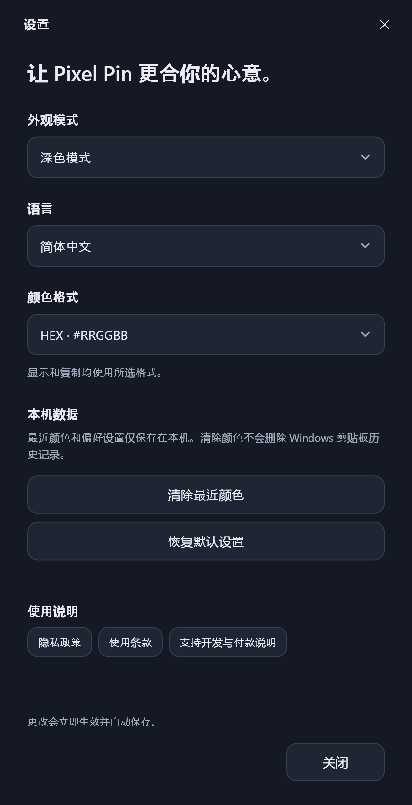

<div align="center">

[한국어](../README.md) · [English](README.en.md) · **简体中文**

<br />

# Pixel Pin

**发现颜色，固定像素，按需复制。**

由 [TeamHJD](https://teamhjd.com/) 制作的简洁 Windows 屏幕取色工具。

[官方网站](https://pixelpin.teamhjd.com/) · [下载](https://github.com/Team-HJD-21/pixel-pin/releases/latest) · [更新日志](https://pixelpin.teamhjd.com/changelog/) · [反馈问题](https://github.com/Team-HJD-21/pixel-pin/issues)

<br />

<sub>界面示例，使用演示颜色。</sub>

</div>

## 简单实用的功能

| 功能 | 说明 |
| :--- | :--- |
| 实时取色 | 读取光标所在位置的单个物理像素。 |
| 点击固定与继续 | 点击一次固定颜色，再次点击继续取色。 |
| 像素放大镜 | 显示周围 17 × 17 像素，并标出中央采样位置。 |
| 五种颜色格式 | HEX、RGB、HSL、HSV，以及仅供参考的 CMYK。 |
| 外观模式 | 浅色、深色或跟随系统，支持响应系统主题变化。 |
| 三种语言 | 한국어、English、简体中文；按钮、设置和提示均提供中文。 |
| 日常便利 | 窗口始终置顶，保留最近复制的 8 个颜色，复制按钮文字自动调整为清晰的黑色或白色。 |

无需账号或安装程序。应用不会将屏幕图像或颜色记录发送到服务器。只有点击制作方链接时，才会使用默认浏览器打开 TeamHJD 网站。

## 下载并运行

1. 在[最新版本](https://github.com/Team-HJD-21/pixel-pin/releases/latest)中下载 **Windows x64 ZIP**。
2. 解压到任意文件夹。
3. 运行 **`PixelPin.exe`**。

面向 **Windows 10 / 11，x64**。官方发行包已包含 .NET 运行时，无需另行安装。

## 取色 → 固定 → 复制

将光标移到应用窗口外，找到需要的颜色。左键点击屏幕固定颜色，再点击复制按钮，即可按设置中选择的格式复制。再次点击屏幕或点击“继续实时取色”，即可继续选择颜色。

| 快捷键 | 操作 |
| :--- | :--- |
| `Ctrl + Shift + C` | 复制当前颜色 |
| `Ctrl + Shift + Space` | 固定颜色或继续取色 |

点击应用内部按钮、设置窗口或下拉选项不会切换取色状态。最近颜色也会按当前选择的格式复制。若快捷键与其他程序冲突，可使用应用内按钮。

> 屏幕点击也会传递给下方的程序。如果只想固定颜色，不想触发按钮或链接，请使用快捷键。

## 按自己的习惯设置

点击右上角的**设置图标**。更改立即生效，并在下次启动时保留。

- **外观模式：** 跟随系统 / 浅色模式 / 深色模式
- **语言：** 한국어 / English / 简体中文
- **颜色格式：** HEX / RGB / HSL / HSV / CMYK

<div align="center"></div>

| 格式 | 示例 | 说明 |
| :--- | :--- | :--- |
| HEX | `#FF8000` | 8 位 sRGB 十六进制表示 |
| RGB | `rgb(255, 128, 0)` | 红、绿、蓝通道数值 |
| HSL | `hsl(30.1, 100%, 50%)` | 色相、饱和度、明度 |
| HSV | `hsv(30.1, 100%, 100%)` | 色相、饱和度、亮度；并非标准 CSS 语法 |
| CMYK | `cmyk(0%, 49.8%, 100%, 0%)` | 由 RGB 换算的参考值；未应用 ICC 印刷配置文件，并非标准 CSS 语法 |

## HDR 与颜色限制

在支持的环境中，应用通过 DirectX 桌面复制保留源像素格式。对于 FP16 scRGB 画面，应用先按 Windows SDR 白电平进行归一化，再换算为 sRGB；超出 SDR 范围的数值会按通道比例缩放。该路径显示为 **`HDR/scRGB → sRGB`**。

**普通 HEX/RGB 数值无法完整重现 HDR 屏幕的亮度、广色域或人眼感受到的画面效果。** 本工具也不会分析印刷配置文件或原始图片的颜色配置文件。与实际 HDR 显示效果的一致性，仍需结合显示器、驱动和颜色处理流程进行验证。

DirectX 采集不可用时，应用会明确显示正在使用 GDI 兼容采集；此时 HDR 颜色可能存在偏差。无法读取受保护内容或安全桌面。实现中考虑了多显示器、负坐标和显示器旋转。

设置和记录保存在 `%LOCALAPPDATA%\PixelPin\settings.json` 与 `history.json`。旧版 Digital Color Meter 的颜色记录会保留。

## 构建

需要 Windows 和 **.NET SDK 10**。应用使用 WPF、Windows API 和 [Vortice.Windows](https://github.com/amerkoleci/Vortice.Windows) DirectX 绑定。

```powershell
git clone https://github.com/Team-HJD-21/pixel-pin.git
cd pixel-pin
dotnet run --project PixelPin.csproj
```

构建包含运行时的单文件版本：

```powershell
dotnet publish PixelPin.csproj -c Release -r win-x64 --self-contained true `
  -p:PublishSingleFile=true -p:IncludeNativeLibrariesForSelfExtract=true `
  -p:EnableCompressionInSingleFile=true -p:DebugType=None -o artifacts/win-x64
```

网站源文件位于 `site/`，通过 GitHub Pages 部署。发布或编辑版本时，会从公开的 GitHub Releases 重新生成下载链接和更新日志；访问网站时不会调用 GitHub API。

<div align="center"><br /><a href="https://teamhjd.com/"><strong>Made by TeamHJD</strong></a><br /><sub>© 2026 TeamHJD. All rights reserved.</sub></div>
